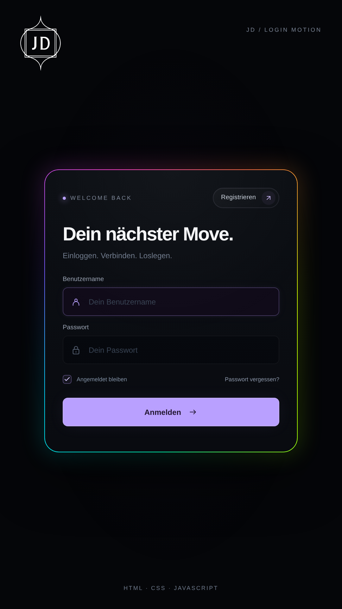

# JD-Impact UI

Animierte UI-Komponenten mit HTML, CSS und JavaScript zum Einbauen in deine Website.

**[Vorschau öffnen und Code kopieren](https://jd-impact.github.io/jd-impact-ui/login.html)**

Die [Startseite](https://jd-impact.github.io/jd-impact-ui/) stellt alle Komponenten vor. Jede Detailseite bietet die tatsächliche Vorschau, die drei Originaldateien zum Kopieren und einen animierten ZIP-Download mit Download Forge.

## Komponenten

- [Login Motion](https://jd-impact.github.io/jd-impact-ui/login.html): Hover, RGB-Rand und 3D-Flip.
- [Download Forge](https://jd-impact.github.io/jd-impact-ui/download.html): echter Download mit Fortschritt und Partikeln.
- [Theme Switch](https://jd-impact.github.io/jd-impact-ui/switch.html): Hell/Dunkel mit Drag und Federbewegung.
- [Copy Button](https://jd-impact.github.io/jd-impact-ui/copy.html): echter Kopier-Button mit Scan-Effekt.
- [Order Truck](https://jd-impact.github.io/jd-impact-ui/order.html): Bestell-Button mit Paket, Laderampe und losfahrendem LKW.

## Login Motion

Eine kompakte Login-Karte, die sich bei Hover oder Antippen öffnet. Ein dünner RGB-Rand bewegt sich um die Karte; Login und Registrierung wechseln mit einem 3D-Flip. Beide Seiten bleiben gleich breit.

- **[Aktuellen Login-Code als ZIP herunterladen](https://jd-impact.github.io/jd-impact-ui/downloads/jd-login-component.zip)**
- **[Einbauanleitung](components/login-motion/README.md)**
- **[Komponenten-Dateien](components/login-motion)**



### Einbauen

1. `login-card.css` und `login-card.js` in dein Projekt kopieren.
2. Die CSS-Datei einbinden.
3. Den Inhalt von `component.html` an der gewünschten Stelle einfügen.
4. JavaScript mit `defer` einbinden.

```html
<link rel="stylesheet" href="login-card.css">
<script src="login-card.js" defer></script>
```

Das Paket enthält eine einzelne `preview.html` zum direkten Öffnen sowie `example.html` als Einbaubeispiel mit den separaten Dateien. Die genaue Anleitung steht im Komponenten-Ordner.

### Funktionen

- Hover-Erweiterung und Bedienung durch Antippen.
- Animierter RGB-Rand und 3D-Flip.
- Getrennte HTML-, CSS- und JavaScript-Dateien, ohne Bibliotheken.
- Styles mit eigenen Klassen, die keine Elemente außerhalb der Karte verändern.
- Tastaturbedienung, Rücksicht auf reduzierte Bewegung und mehrere unabhängige Karten pro Seite.
- Normale Formulare für die Verbindung mit deinem eigenen System.

Die Komponente liefert die Optik und Effekte. Automatisch getippte Daten, künstlicher Mauszeiger und Matrix-Hintergrund gehören zur Reel-Präsentation.

## Komponenten

- [Login Motion](components/login-motion): Hover-Login und Registrierung mit 3D-Flip.
- [Download Forge](components/download-forge): echte Downloads mit bytebasiertem Fortschritt.
- [Theme Switch](components/theme-switch): Hell-Dunkel-Schalter mit Drag und Federanimation.
- [Copy Button](components/copy-button): echte Clipboard-Funktion mit Scan-Effekt und manuellem Fallback.
- [Order Truck](components/order-truck): animierte Bestellbestätigung mit Paket, LKW und Callback fürs eigene Bestellsystem.

## Instagram

**[@jd_impact](https://www.instagram.com/jd_impact/)** · JD-Impact

Stichwort für diese Komponente: **LOGIN**.

Der private Veröffentlichungsablauf für Reels und passende Code-DMs ist in [Instagram-Automation](automation/instagram/README.md) beschrieben. Die Zernio-Anbindung läuft ausschließlich serverseitig; Schlüssel gehören weder in die Komponenten noch in die öffentliche Website.

## Code-Seite aktualisieren

Alle Komponentenseiten verwenden dieselbe Vorlage in `templates/component-page.html` und dieselbe `docs/site.css`. Das Layout der Login-Seite ist der Standard: Header, Matrix-Hintergrund, Vorschau, Code-Bereich, Download, Instagram und Einbauanleitung. Komponentenspezifische Texte und Links stehen in `templates/component-pages.json`; die Optik der Komponenten selbst bleibt unabhängig davon.

Die statische Seite liegt unter `docs/` und wird über GitHub Pages veröffentlicht. Nach Änderungen an der Login-Komponente `python scripts/build-library.py` ausführen. Das erzeugt aus denselben HTML-, CSS- und JavaScript-Dateien die Einbaubeispiele, die ZIP, die Code-Ansicht und die Dateien für die Live-Vorschau. So zeigen Website und Download denselben Komponentenstand.
